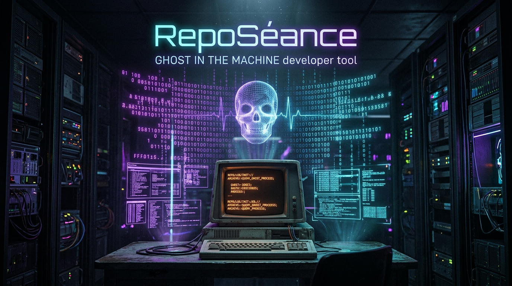
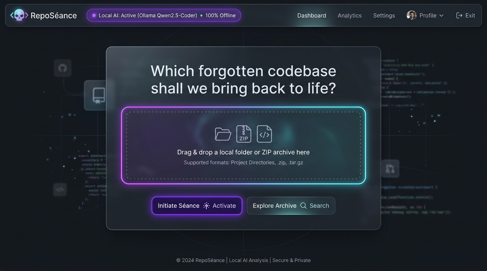
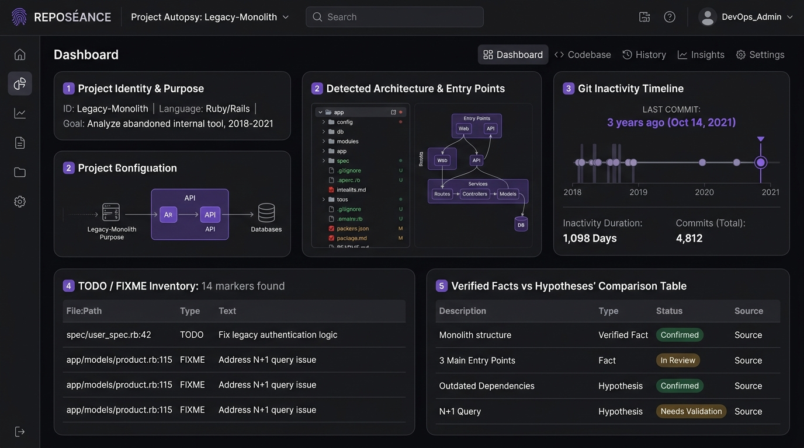
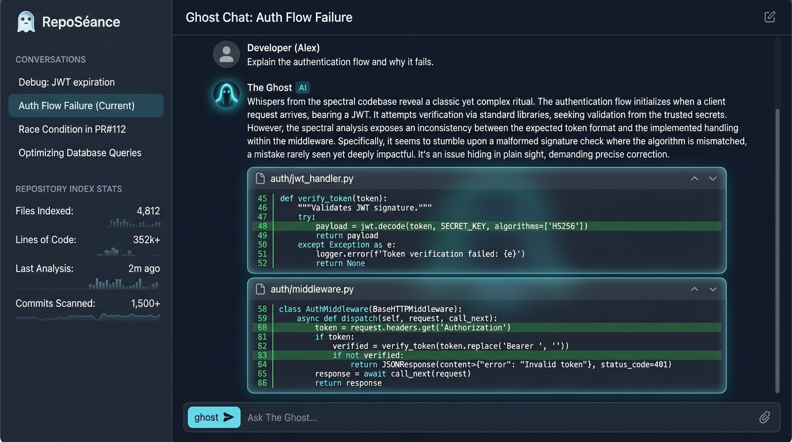
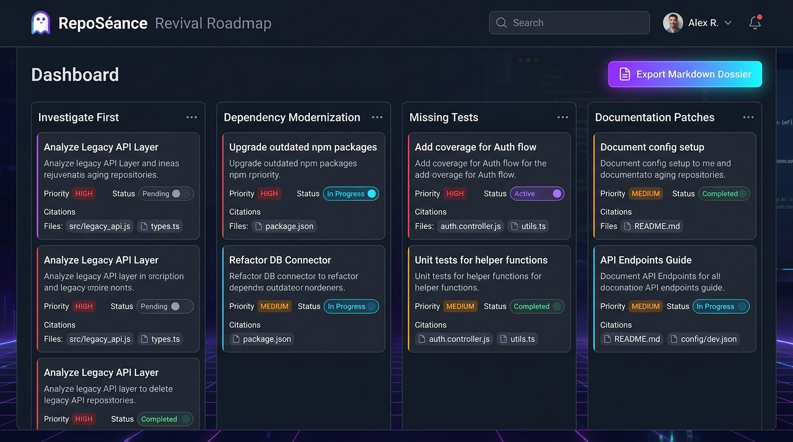

# 👻 RepoSéance

> **Every repository has a story. Some are simply waiting to be resurrected.**

[](https://dev.to/challenges/hacktoberfest-week4-2026-10-26)
[](LICENSE)
[](https://www.python.org/)
[](https://ollama.com/)
[]()



**RepoSéance** is a local-first, privacy-respecting software archaeology workbench. It takes neglected, abandoned, or undocumented software repositories and conducts an AI-powered digital séance: reconstructing project architectures, unearthing buried `TODO`s, identifying broken dependencies, and generating evidence-backed revival roadmaps—**all running 100% offline on your local machine with open-weight models**.

---

## 🔮 Key Features

- **🕯️ The Séance Chamber:** Drag & drop any local project directory or ZIP archive. RepoSéance safely inspects code without executing untrusted scripts.
- **📜 Project Autopsy:** Automatically reconstructs project purpose, main entry points, language distributions, and distinguishes **Verified Facts** from **AI Hypotheses**.
- **⏳ Git Inactivity Timeline:** Identifies dormancy duration, commit trends, top authors, and stalled files without third-party services.
- **🚧 Incomplete Work Inventory:** Deterministically catalogs and highlights buried `TODO`, `FIXME`, `HACK`, and `BUG` markers with exact line numbers.
- **👻 Ghost Chat (Retrieval-Augmented Generation):** Conversational AI assistant with a subtle haunted-archive persona that answers technical inquiries strictly backed by collapsible **Evidence Cards** citing exact file paths and line ranges (`auth.py:L45-L62`).
- **🗺️ Interactive Revival Roadmap:** Prioritized triage checklist (Investigate First, Modernization, Missing Tests, Documentation) with local state persistence (Pending, In Progress, Completed).
- **📄 One-Click Markdown Dossier:** Export a comprehensive software archaeology report ready for GitHub issues or team handoffs.
- **🛡️ Secret Masking & Sandboxing:** Automatically scrubs API keys, AWS credentials, JWTs, and database connection strings before indexing.

---

## 🏗️ Architecture

```
Local Repository / ZIP ──> Safe Scanner & Secret Redactor ──> Deterministic AST & Git Parser
                                                                        │
                                ┌───────────────────────────────────────┴───────────────────────────────────────┐
                                ▼                                                                               ▼
             Local Embeddings (Nomic / BGE)                                                     Git History & TODO Extractor
                                │                                                                               │
                                ▼                                                                               │
                         Local Vector Index                                                                     │
                                │                                                                               │
                                └───────────────────────────────┬───────────────────────────────────────────────┘
                                                                ▼
                                                Evidence Retrieval & Chunk Citations
                                                                │
                                ┌───────────────────────────────┴───────────────────────────────┐
                                ▼                                                               ▼
                 Ollama Runtime (Qwen2.5 / Gemma 2)                              Offline Deterministic Autopsy Fallback
                                │                                                               │
                                └───────────────────────────────┬───────────────────────────────┘
                                                                ▼
                                            Digital Séance Dashboard & Ghost Chat
                                            - Project Autopsy & Architecture
                                            - Evidence-Cited Q&A
                                            - Prioritized Revival Roadmap
                                            - Exportable Markdown Dossier
```

---

## 📸 Screenshots

| 🕯️ The Séance Chamber | 📜 Project Autopsy |
|:---:|:---:|
|  |  |

| 👻 Ghost Chat with Evidence Cards | 🗺️ Interactive Revival Roadmap |
|:---:|:---:|
|  |  |

---

## ⚡ Quickstart

### Prerequisites
- Python 3.10+
- (Optional) [Ollama](https://ollama.com/) with `qwen2.5-coder:7b`, `qwen2.5:3b`, or `gemma2:2b`.
  *(If Ollama is not installed, RepoSéance automatically activates its built-in deterministic heuristic engine for 100% offline functionality!)*

### 1. Clone & Install
```bash
git clone https://github.com/Vaibhav-1819/RepoS-ance.git
cd RepoS-ance

pip install -r backend/requirements.txt
```

### 2. Run the Application
```bash
python -m uvicorn backend.main:app --reload --port 8000
```

Open your browser at **[http://localhost:8000](http://localhost:8000)** to enter the Séance Chamber!

---

## 🧪 Running Automated Tests

```bash
python -m pytest backend/tests/ -v
```

Tests cover:
- Secret redaction and credential protection.
- Sensitive file exclusion (`.env`, `.pem`, private keys).
- Syntax-aware bounded code chunking.
- Semantic vector retrieval and keyword search.
- Deterministic heuristic autopsy generation.
- Full FastAPI endpoint integration (import, chat, task update, report export).

---

## 🔒 Privacy & Security

- **No Remote AI APIs:** Source code never leaves your device.
- **No Automatic Code Execution:** Never runs `pip install`, `npm install`, build tools, or repository scripts.
- **Path Traversal Protection:** Archive extractions strictly validate paths to prevent traversal exploits (`../../`).

---

## 📜 License

This project is licensed under the [MIT License](LICENSE).
