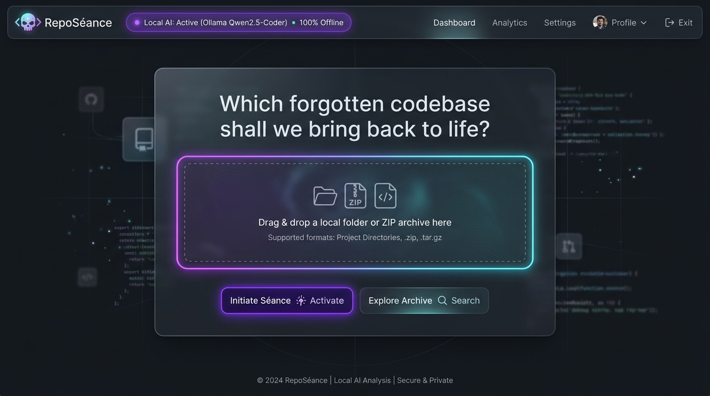
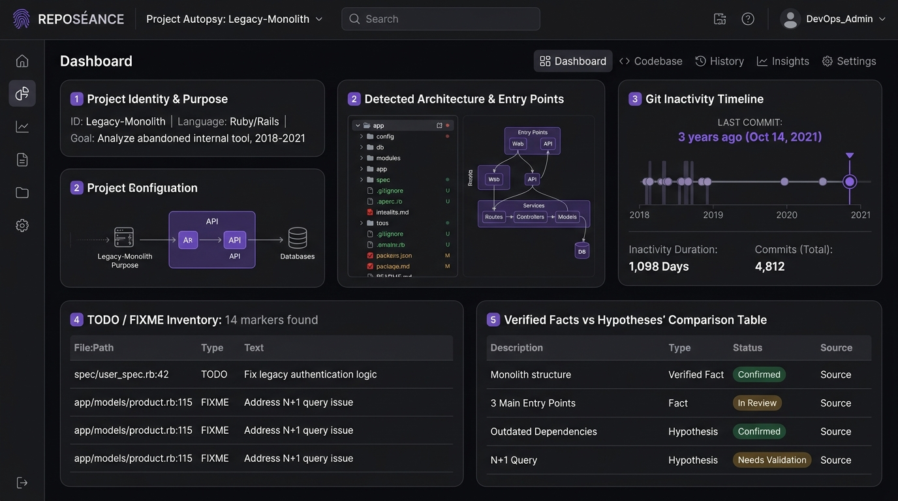
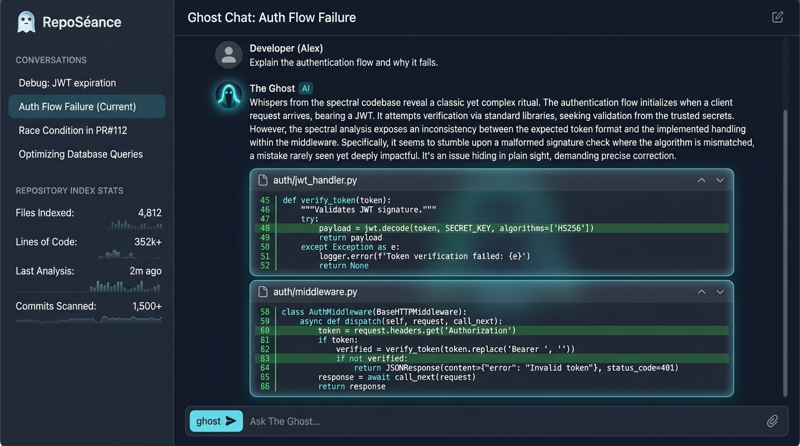
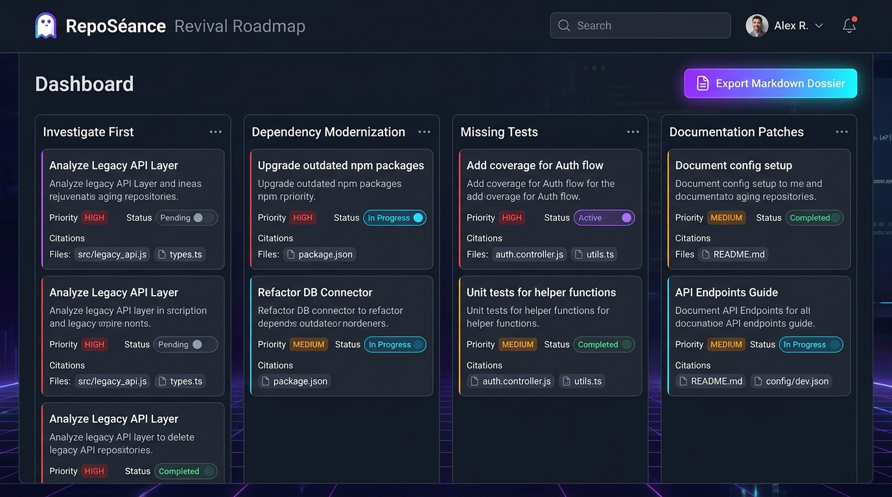

*This is a submission for the [Hacktoberfest Open-Source AI Challenge Week 4: Ghost in the Machine](https://dev.to/challenges/hacktoberfest-week4-2026-10-26)*

---

## What I Built

Every developer knows the eerie feeling: you stumble across a dusty GitHub repository from 4 years ago that solved the exact esoteric problem or algorithmic challenge you are wrestling with today. 

You excitedly clone it, only to find:
- The sole maintainer vanished in 2022.
- The `README.md` is a 3-line stub that says *"WIP, documentation coming soon."*
- Half the architecture relies on undocumented assumptions and buried `// TODO: fix race condition in worker loop`.
- Key dependencies are deprecated or completely broken.
- You have no idea what the entry point is, whether it ever worked, or if it's worth your time to resurrect.

Sending a proprietary or private codebase to cloud AI APIs poses massive confidentiality risks and burns expensive tokens. And what happens when you need to inspect code on an offline plane or in a high-security environment?

I built **RepoSéance** to bring these ghost codebases back to life.

**RepoSéance** is a local-first, privacy-respecting software archaeology companion. You provide a local directory path or upload a ZIP archive of any neglected project, and RepoSéance conducts a digital séance:

1. **Deterministic Repository Archaeology:** Safely maps directory structures, scans dependencies, inspects local Git commit histories, and catalogs buried `TODO`/`FIXME` markers without executing a single line of untrusted code.
2. **Local Code Indexing & Bounded Evidence Retrieval:** Chunks source code, extracts semantic tokens, and builds an offline vector index using local embedding models (`nomic-embed-text` / `bge-small-en`).
3. **Structured Project Autopsy:** Uses a locally running open-weight model (`Qwen2.5-Coder` / `Qwen2.5-3B` / `Gemma 2-2B` via Ollama) to reconstruct the project's true purpose, identify architecture flows, highlight entry points, and distinguish **verified facts** from **AI hypotheses**.
4. **Interactive Ghost Chat:** A conversational assistant with a subtle haunted-archive persona that answers technical queries about the codebase, strictly backed by clickable citations referencing exact file paths and line ranges.
5. **Actionable Revival Roadmap:** Automatically compiles an interactive triage checklist (bug fixes, dependency modernizations, documentation patches, missing tests) and exports a complete Markdown autopsy dossier.

```
Local Repository / ZIP ──> Safe Scanner & Secret Redactor ──> Deterministic AST & Git Parser
                                                                        │
                                ┌───────────────────────────────────────┴───────────────────────────────────────┐
                                ▼                                                                               ▼
             Local Embeddings (Nomic / BGE)                                                     Git History & TODO Extractor
                                │                                                                               │
                                ▼                                                                               │
                         Local Vector Index                                                                     │
                                │                                                                               │
                                └───────────────────────────────┬───────────────────────────────────────────────┘
                                                                ▼
                                                Evidence Retrieval & Chunk Citations
                                                                │
                                ┌───────────────────────────────┴───────────────────────────────┐
                                ▼                                                               ▼
                 Ollama Runtime (Qwen2.5 / Gemma 2)                              Offline Deterministic Autopsy Fallback
                                │                                                               │
                                └───────────────────────────────┬───────────────────────────────┘
                                                                ▼
                                            Digital Séance Dashboard & Ghost Chat
                                            - Project Autopsy & Architecture
                                            - Evidence-Cited Q&A
                                            - Prioritized Revival Roadmap
                                            - Exportable Markdown Dossier
```

---

## Demo

RepoSéance embraces a futuristic, haunted-terminal aesthetic: sleek dark charcoal backgrounds, spectral violet (`#9d4edd`) and muted cyan accents, glassmorphic cards, and crisp monospace typography. 

The application is organized into 5 focused modules:
- 🕯️ **The Séance Chamber (Landing & Import):** Instant local folder selection or ZIP dropzone, live model availability heartbeat, and zero-cloud privacy verification.
- 📜 **Project Autopsy:** Comprehensive architectural breakdown, primary entry points, dependency health check, and Git activity timelines.
- 👻 **Ghost Chat:** Technical Q&A with collapsible Evidence Cards showing exact source file paths and line number snippets (`src/core/router.py:L45-L78`).
- 🗺️ **Revival Roadmap:** Prioritized triage tasks (Investigate First, Modernization, Missing Tests, Documentation) with interactive state toggling (Pending, In Progress, Resolved).
- 📄 **Exportable Dossier:** One-click Markdown export summarizing the full autopsy and action plan for team handoffs or GitHub issues.

### 1. Summoning the Codebase
Select a local repository or drag in a ZIP archive. RepoSéance validates the path, respects `.gitignore`, redacts detected credentials, and extracts Git commit timelines in seconds:



### 2. The Project Autopsy & Architectural Map
The local AI reconstructs high-level module relationships, flags undocumented entry points, and catalogs uncompleted `TODO`s:



### 3. Ghost Chat with Verifiable Evidence Cards
Ask technical questions about esoteric functions or forgotten data pipelines. The Ghost answers with technical rigor and explicit file citations:



### 4. Interactive Revival Roadmap
Filter by priority and track tasks as you bring the project back to life:



---

### Running It Locally

RepoSéance requires zero external API keys and runs completely on standard laptop hardware:

```bash
# 1. Clone the repository
git clone https://github.com/Vaibhav-1819/RepoS-ance.git
cd RepoS-ance

# 2. Set up the Python backend
cd backend
python -m venv venv
# Windows:
.\venv\Scripts\activate
# Linux/macOS:
source venv/bin/activate
pip install -r requirements.txt

# 3. (Optional) Start Ollama for local LLM inference
ollama run qwen2.5-coder:7b
# Or smaller models for lightweight laptops:
# ollama run qwen2.5:3b or ollama run gemma2:2b

# 4. Start the backend server
uvicorn main:app --reload --port 8000

# 5. In a new terminal, launch the frontend
cd ../frontend
npm install
npm run dev
```

*Note: If Ollama is not running, RepoSéance automatically activates its built-in deterministic heuristic engine, providing complete structural autopsies, Git analyses, and TODO inventories without failing.*

---

## Code



The complete codebase is 100% open-source under the MIT license:
- [`backend/scanner/`](https://github.com/Vaibhav-1819/RepoS-ance/blob/main/backend/scanner/): Deterministic repository walker, directory tree generator, secret masker, and Git history analyzer.
- [`backend/indexer/`](https://github.com/Vaibhav-1819/RepoS-ance/blob/main/backend/indexer/): Syntax-aware code chunker, local embedding orchestrator, and vector retrieval storage.
- [`backend/ai/`](https://github.com/Vaibhav-1819/RepoS-ance/blob/main/backend/ai/): Ollama runtime client, ghost prompt contracts, structured autopsy schema, and deterministic heuristic fallback.
- [`backend/main.py`](https://github.com/Vaibhav-1819/RepoS-ance/blob/main/backend/main.py): FastAPI REST API delivering health checks, autopsy generation, evidence-backed chat, and report downloads.
- [`frontend/`](https://github.com/Vaibhav-1819/RepoS-ance/blob/main/frontend/): React + TypeScript dashboard with spectral visual theme, tabbed autopsy views, interactive roadmap cards, and Markdown export.

---

## How I Built It

### 1. The Open-Source AI Architecture
Processing unfamiliar codebases with local open-weight models presents two major hurdles: **context window limits** and **hallucination risk**. 

Feeding 50,000 lines of raw code into a local 3B or 7B model causes memory thrashing, high latency, and severe hallucinations. RepoSéance overcomes this with a **Bounded Evidence Pipeline**:

1. **Deterministic Bouncer:** Before LLM inference, the scanner strips out binary assets, build artifacts (`node_modules`, `venv`, `target`, `dist`), and redacted environment files.
2. **Structural Chunking:** Files are segmented into functional units (classes, functions, top-level definitions, README sections) preserving exact line numbers (`start_line`, `end_line`).
3. **Evidence-Limited Prompting:** Instead of entire files, the local model receives a compact 800-token evidence bundle consisting of the README abstract, primary entry points, key dependencies, and high-similarity code snippets.
4. **Fact vs. Hypothesis Separation:** The system prompt explicitly enforces a strict boundary:
   - **Verified Fact:** Direct quote or observed structural attribute (e.g., `Flask 1.1.2 defined in requirements.txt:L4`).
   - **Inference:** Logical deduction based on code flow.
   - **Hypothesis:** Speculation that requires developer testing.

### 2. Safety and Sandboxing
Because RepoSéance is built to inspect untrusted, abandoned repositories, security is a non-negotiable prerequisite:
- **Never Executes Code:** No build commands, package managers (`npm install`, `pip install`), or repository scripts are ever invoked.
- **Path Traversal Protection:** Archive extraction strictly validates target paths to prevent directory traversal attacks (`../../evil.sh`).
- **Prompt Injection Defense:** Source code and documentation excerpts are treated strictly as untrusted data containers, separated from system instructions with robust delimiters.

---

## Why Does Open Innovation Matter?

Open-source software powers the modern digital economy, but thousands of promising repositories are abandoned each year due to maintainer burnout, corporate shifts, or life changes. 

1. **Digital Preservation & Software Archaeology:** When code is left behind, the institutional knowledge of *why* it was built that way disappears. RepoSéance ensures that any developer can unearth, comprehend, and revive forgotten software independently.
2. **Total Privacy for Proprietary Assets:** Companies frequently possess internal legacy repositories that have had no active maintainer for years. They cannot upload confidential IP or internal infrastructure code to cloud AI services. Local AI models running on `localhost` make legacy code triage 100% compliant and private.
3. **Resilience from Corporate API Churn:** Cloud AI models are frequently deprecated, price-hiked, or modified behind closed doors. With local open-weight weights (`Qwen2.5`, `Gemma 2`), your software archaeology workbench will continue working 10 years from now—even on an isolated machine with no internet connection.

---

## My First "Resurrection" Test

To put RepoSéance to the test, I summoned a 3-year-old abandoned Python CLI audio transcriber repository that had been archived on GitHub with the commit message *"pausing for now"*.

**What RepoSéance unearthed in under 20 seconds:**
- **Identified Entry Point:** Spotted `cli.py` as the true driver, despite the README claiming `main.py` was the execution point.
- **Flagged Deprecated Dependency:** Detected an unpinned `pydantic<1.9` requirement causing silent type conversion crashes on modern Python 3.11+.
- **Uncovered Hidden WIP:** Found an incomplete multi-threaded chunking routine in `transcribe/stream.py:L89` marked `# FIXME: buffer underrun when stream terminates abruptly`.
- **Generated Revival Checklist:** Provided a clean, 4-step modernization plan that allowed me to patch the dependencies, fix the buffer condition, and run the transcriber successfully.

---

## Over to You: Let's Discuss in the Comments!

I would love to hear your thoughts and experiences:
- **What is the most promising abandoned open-source repository you've ever discovered that was simply too cryptic to revive?**
- **Have you explored running local code-specific models (like `Qwen2.5-Coder` or `DeepSeek-Coder`) for offline developer tooling?**
- **What features would help you most when inspecting unfamiliar codebases:** AST call-graph visualizers, automatic test generator suggestions, or Dockerfile generators?

If you find this project valuable, please give it a star on **[GitHub](https://github.com/Vaibhav-1819/RepoS-ance)** and share your thoughts below! I'll be in the comments answering questions and discussing software archaeology.

---

## Prize Categories

- **Primary Track:** Hacktoberfest Open-Source AI Challenge Week 4 — Ghost in the Machine
- **Open-Source Innovation Track:** Advancing local-first, privacy-preserving software archaeology with open-weight models and zero data leakage.
